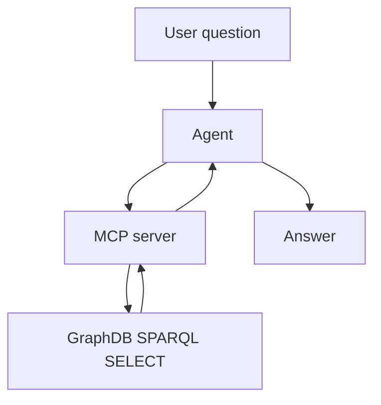

# MCP для GraphDB и агент с доступом к живой базе

## Цель
Обернуть read‑only доступ к GraphDB в MCP‑сервер и подключить ИИ‑агента, который отвечает на вопросы по живым данным через SPARQL `SELECT` без изменения графов.

## Контекст текущей системы
- Python сервер уже выполняет `SELECT` запросы к GraphDB через `RDFStoreClient.select`.
- Доступ к данным уже read‑only и основан на готовых графах.

## Архитектура MCP‑доступа

### 1) MCP‑сервер (Python)
**Роль:** единая точка доступа для агента.

**Основные инструменты MCP:**
1. `sparql_select` — исполняет read‑only `SELECT` запросы.
2. `list_queries` — возвращает список предопределённых шаблонов запросов.
3. `run_named_query` — запускает именованный запрос с параметрами.
4. `explain_schema` — возвращает краткие сведения по онтологии и доступным признакам.

**Безопасность:**
- Запрет `INSERT`, `DELETE`, `LOAD`, `CLEAR`, `DROP` и любых UPDATE‑операций.
- Белый список функций и ограничение на `SERVICE`.
- Ограничение времени выполнения и размера ответа.

### 2) Адаптер к GraphDB
**Роль:** инкапсулировать доступ к GraphDB.

**Реализация:**
- Использовать логику `RDFStoreClient.select` как базу.
- Поддержать конфигурацию через `.env` или переменные среды.
- Единый метод `execute_select(query)`.

### 3) Агент
**Роль:** формулировать вопросы пользователя, выбирать инструмент, интерпретировать результат.

**Вариант интеграции:**
- Агент вызывает MCP‑сервер и получает JSON‑результаты.
- На стороне агента формируется итоговый ответ для пользователя.

---

## Контракт инструментов MCP

### `sparql_select`
- Вход: `query`.
- Выход: `bindings` в формате SPARQL JSON.
- Проверка: только `SELECT`, без update‑операций.

### `list_queries`
- Вход: отсутствует.
- Выход: список именованных шаблонов.

### `run_named_query`
- Вход: имя запроса + параметры.
- Выход: результат `SELECT`.

### `explain_schema`
- Вход: отсутствует.
- Выход: базовое описание сущностей и признаков.

---

## Модель ограничений

- Разрешены только `SELECT` запросы.
- Ограничение ответа: лимит строк + лимит размера JSON.
- Ограничение времени выполнения: таймаут на запрос.
- Логирование запросов для аудита.

---

## Roadmap

1. **Проектирование MCP‑сервера**
   - Определить API инструментов и формат ответов.
   - Утвердить политику безопасности запросов.

2. **Реализация адаптера GraphDB**
   - Переиспользовать `RDFStoreClient.select`.
   - Добавить валидацию запросов.

3. **Набор шаблонных запросов**
   - Подготовить 10–15 «типовых» запросов под ключевые метрики.

4. **Запуск в Docker**
   - Контейнер MCP‑сервера в одной сети с GraphDB.
   - Конфигурация через `.env`.

5. **Интеграция агента**
   - Подключение к MCP.
   - Первые сценарии вопросов и ответы на живых данных.

---

## Текстовые запросы к агенту

### Как это работает
1. Пользователь задаёт вопрос естественным языком.
2. Агент выбирает инструмент MCP и формирует `SELECT`.
3. MCP‑сервер выполняет `SELECT` в GraphDB и возвращает результаты.
4. Агент интерпретирует ответы и формулирует итог.

### Пример сценария вопрос→SPARQL→ответ

**Вопрос:** Сколько красных сделок в категории 2 за последние 7 дней?

**SPARQL (через MCP `sparql_select`):**
```sparql
PREFIX b24: <https://example.org>
SELECT (COUNT(?deal) AS ?red_deals)
WHERE {
  ?deal a b24:Deal ;
        b24:stageSemantic "P" ;
        b24:categoryCode "2" ;
        b24:lastActivityTime ?lastActivity .
  FILTER(?lastActivity <= (NOW() - "P7D"^^xsd:duration))
}
```

**Ответ агента:** В категории 2 сейчас N красных сделок за последние 7 дней. Хотите список сделок и ответственных?

---

## Mermaid схема



---

## Открытые вопросы
- Требуется ли отдельный инструмент для безопасного «семантического поиска» по онтологии.
- Нужен ли кэш на уровне MCP‑сервера.
- Нужно ли ограничивать объём и сложность запросов по ролям агента.
