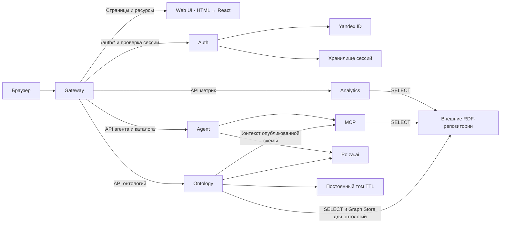

# Архитектура перехода CRM Pulse Monitor на микросервисы

Из `server.py` выделяем три сервиса — Auth для Yandex ID и сессий, Analytics для метрик CRM и Ontology для управления онтологиями. Gateway сохраняет единый внешний адрес для страниц, входа и API. UI получает собственную границу развёртывания, чтобы текущие HTML-страницы можно было постепенно заменить React-приложением. Agent и MCP уже запускаются отдельно. Первое развёртывание остаётся в монорепозитории и Docker Compose, с внешней RDF-инфраструктурой и текущими браузерными маршрутами.

[Дорожная карта реализации и проверок](microservices_implementation_roadmap.md).

Состояние реализации и проверок ведётся в соответствующем разделе [дорожной карты](microservices_implementation_roadmap.md).

## Текущее устройство

| Компонент | Как работает сейчас | Что определяет границу |
| --- | --- | --- |
| `server.py` | Статика, OAuth Yandex ID и сессии в памяти, маршруты аналитики, онтологий и каталога запросов, прокси агента. `RDFStoreClient` совмещает SPARQL-транспорт и расчёт показателей. | Gateway маршрутизирует запросы и применяет решение Auth о допуске. UI можно переносить по страницам. |
| Аналитика | Сделки, лиды и сотрудники используют общие выборки, справочники и кэш. `view-state` строится из тех же метрик и локального справочника схемы. | Сделки, лиды, сотрудники и правила адаптивного вида образуют один сервис. |
| Онтологии | `ontology_admin.py` управляет Turtle и публикацией. `ontology_assistant.py` читает редактор и сохранённый файл, получает опубликованную схему и статистику через MCP и предлагает изменения через Polza.ai. HTTP-обработчики находятся в `server.py`. | Сохранённые TTL, контроль версий и публикация имеют одного владельца. Помощник остаётся рядом с этим контуром и получает интерфейс чтения. |
| Агент и MCP | `agent_service.py` ведёт диалог с Polza.ai и вызывает MCP по HTTP. MCP импортирует RDF-клиент, рендеринг запросов и профилирование из `server.py`. | Существующую границу HTTP сохраняем. Прямые импорты MCP из шлюза заменяем небольшими общими модулями. |

Источники — [server.py](../server.py), [Compose](../compose.yaml), [реализация MCP](../mcp/mcp_server.py), [каталог запросов MCP](../mcp/mcp_queries.py), [управление онтологиями](../docs/ONTOLOGY_MANAGEMENT_PLAN.md), [помощник онтологий](../docs/ONTOLOGY_ASSISTANT_IMPLEMENTATION_PLAN.md).

## Целевая схема

| Сервис | Ответственность и маршруты | Состояние и доступ |
| --- | --- | --- |
| Gateway | Направляет запросы страниц и ресурсов в Web UI, `/auth/*` в Auth и `/api/*` в соответствующие сервисы. Запрашивает у Auth проверку сессии для защищённых маршрутов. | Единственная публичная точка входа приложения. Хранит конфигурацию маршрутов и межсервисного доступа. |
| Auth | `/auth/login`, `/auth/callback`, `/auth/logout`, `/auth/status` и закрытый `GET /internal/session` для Gateway. Владеет обменом кода Yandex ID, проверкой доменов, OAuth state, выпуском cookie и отзывом сессий. | Только Auth получает секрет Yandex и имеет доступ к хранилищу сессий. |
| Web UI | `/`, `/leads`, `/employees`, `/agent`, `/queries`, `/tools/*`, `/ontologies` и действующие алиасы. Сначала текущие HTML, JS и CSS, затем React по маршрутам. | Отдельная сборка и выпуск. Клиент обращается к `/api/*` и `/auth/*` через тот же origin. |
| Analytics | `/api/pulse`, `/api/deal-activity-distribution`, `/api/red-deals`, `/api/recent-activities`, `/api/employee-recent-activities`, `/api/lead-pulse`, `/api/lead-conversion-trend`, `/api/lead-employee-pulse`, `/api/view-state`. Внутри остаются формулы, правила, проверка фильтров и справочники. | Локальный кэш результатов и версии правил. RDF-доступ только на чтение. |
| Ontology | `/api/ontologies*` и `/api/ontology-assistant/*`. Владеет файлами, ревизиями, карантином, статистикой классов, публикацией и проверкой результата. | Единственный пишущий процесс с томом `ontologies/`. Только Ontology получает полномочия на публикацию графов. |
| Agent | `/api/agent*`, включая `/api/agent/query`. Владеет диалогом, прогрессом и выполнением запросов через MCP. Предлагаем перенести сюда и модуль каталога `/api/published-queries*`. | История и прогресс в памяти одного процесса на первом этапе. Отдельный постоянный том `published_queries` для каталога. Polza.ai и внутренний MCP. |
| MCP | Существующий JSON-RPC `/mcp` и каталог именованных запросов. Сохраняет проверку SELECT и ограничения выдачи. | RDF-доступ только на чтение. Для существующих локальных MCP-клиентов можно сохранить отдельный loopback endpoint через профиль Compose. |

Внутренние сервисы принимают HTTP/JSON, MCP сохраняет JSON-RPC. На старте внутренние API могут обслуживать те же пути, что и шлюз. Сетевые границы определяются потребителями и правами доступа. Общие Python-модули содержат конфигурацию подключения, SPARQL-транспорт, подстановку параметров и техническую телеметрию. Расчёты показателей и HTTP-обработчики принадлежат своим сервисам. Для каждого сервиса нужен собственный entrypoint и независимая сборка и доставка. Базовый образ и `uv.lock` можно использовать совместно.

Сохраняем действующее распределение RDF-репозиториев, включая отдельную аналитическую проекцию MCP, если она настроена. Поддержку GraphDB/Fuseki сохраняем для чтения, публикацию оставляем GraphDB. Ограничение записи конкретными графами проверяем на целевой конфигурации GraphDB. URI вычисляет Ontology из slug, и только у него есть учётные данные для записи. Общий Python-клиент выполняет запросы напрямую из своего сервиса.

## Auth и браузерные сессии

1. Браузер открывает `/auth/login` на внешнем адресе приложения. Auth создаёт одноразовый `state` с TTL, привязывает его к браузеру и сохраняет проверенный локальный путь возврата. Yandex возвращает браузер по зарегистрированному `/auth/callback` через Gateway. При прежнем внешнем адресе текущий callback URI можно сохранить.
2. Auth проверяет и погашает `state`, обменивает код на токен и проверяет профиль по действующим ограничениям домена. Браузер получает только непрозрачный идентификатор сессии в `HttpOnly` cookie с `SameSite=Lax` и `Secure` на HTTPS. Секрет и токены Yandex остаются в Auth.
3. Для защищённых страниц и API Gateway обращается к `GET /internal/session` по аутентифицированному внутреннему каналу и передаёт только cookie приложения. Auth возвращает `200` и стабильный ID пользователя для действующей сессии или `401` для отсутствующей либо истёкшей. Gateway проверяет каждый защищённый запрос, чтобы отзыв сессии действовал сразу. Он удаляет присланные браузером заголовки идентичности и передаёт проверенный ID только нужным сервисам. Внутренний маршрут отсутствует в публичной таблице.
4. Для production предлагаем Redis, доступный Auth, с TTL для сессий и состояния OAuth. Logout удаляет серверную сессию и очищает cookie. Сбой Yandex влияет на новые входы, а проверка существующей сессии зависит от Auth и его хранилища. При недоступности проверки Gateway закрывает защищённый маршрут и возвращает `503`, чтобы UI различал сбой и истечение сессии.

Вход в приложение и права на операции разделены. Auth подтверждает личность и допуск по домену. Ontology и каталог запросов сохраняют текущие проверки административного заголовка. Для запросов записи используется внешний `PUBLIC_ORIGIN`. Перевод администрирования на серверные роли можно выпустить отдельно после проверки совместимости обоих интерфейсов. Режим `AUTH_ENABLED=0` включается явно в локальном профиле.

Источники — [текущие обработчики OAuth](../server.py#L1675), [настройки OAuth](../.env.example#L18), [конфигурация приложения](../docs/CONFIGURATION.md), [OAuth 2.0 Security Best Current Practice](https://www.rfc-editor.org/rfc/rfc9700.html#section-2.1).

## Переход на React и роль Node.js

Для первого выпуска предлагаем **React с клиентским рендерингом**. Страницы закрыты входом, а показатели, чат и редактор уже получают данные через JSON API. Node.js используется при сборке React. Собранные файлы раздаёт Web UI за Gateway. React запускает вход переходом на `/auth/login`, получает состояние из `/auth/status` и выполняет API-запросы по относительным URL с сессионной cookie.

**React с сервером на Node.js** остаётся вариантом при появлении задачи на серверный рендеринг или сборку данных для страниц. Например, Next.js может заменить статический Web UI за тем же Gateway. Его серверные запросы идут через согласованный внутренний вход Gateway с сессией текущего пользователя. Проверка сессии остаётся в Auth, а ответы с пользовательскими данными исключаются из общего кэша. Браузерные маршруты `/auth/*` и `/api/*` по-прежнему обрабатывает Gateway. [Документация React о клиентском и серверном рендеринге](https://react.dev/learn/creating-a-react-app).

Для поэтапного переноса Gateway направляет выбранные страницы в React-сборку, остальные страницы обслуживает текущий UI. У сборки отдельный префикс ресурсов. Fallback на HTML React применяется только к маршрутам React и только после проверки маршрутов API и Auth. В локальной разработке proxy dev-сервера направляет `/auth/*` и `/api/*` в Gateway. Callback и `PUBLIC_ORIGIN` тестового окружения указывают на тот же внешний адрес, с которого браузер открывает UI. Для API зафиксировать схемы ответов и на их основе типизировать клиент TypeScript. Смену редиректа для истёкшей сессии на явный JSON `401` вводить после проверки совместимости с оставшимися HTML-страницами.

## Контракты и состояние

- **Браузер.** Сохранить методы, пути, параметры, JSON, HTTP-статусы и заголовки, включая редирект на вход, cookie и `X-Request-ID`. Переносить группу аналитических маршрутов целиком, чтобы страница и `view-state` использовали один набор формул и один кэш. Сохранить HTTP 200 с `available: false` там, где его ждёт интерфейс. Ошибку доступа по-прежнему возвращает шлюз.
- **Развёртывание.** Сервисы доступны доверенным клиентам по приватной сети с аутентификацией межсервисных запросов. Выдавать каждому сервису только нужные секреты. На переходном этапе действующий административный секрет получают Ontology и модуль каталога запросов в Agent, которым нужно сохранить совместимость текущих операций записи.
- **Аналитика.** Сохранить TTL кэша 30 секунд и текущее поведение при сбое RDF. Общий `CACHE_LOCK` сейчас удерживается во время сетевых SELECT. После фиксации эквивалентности заменить его синхронизацией загрузок по ключу и ограничить суммарное число запросов к RDF. Многорепличный кэш и предел возраста устаревших данных вводить после замеров. Включить версию правил и справочника схемы в диагностику. Согласовать справочник наблюдаемых свойств для `view-state` и MCP отдельно от опубликованной схемы, которую помощник получает через MCP.
- **Агент.** При масштабировании хранить историю и прогресс с TTL в общем хранилище и привязать их к пользователю шлюза, сохранив внешний формат `session_id` и `request_id`. До масштабирования проверить одновременный чат и опрос прогресса. Сейчас async-обработчик вызывает синхронный сетевой код. Выделить блокирующую работу в ограниченный пул или перейти на асинхронный транспорт. Задать общий бюджет операции, который ограничивает каждый вызов Polza.ai и MCP. Текущий пример конфигурации задаёт `AGENT_TIMEOUT=60` и `POLZA_TIMEOUT=180`.
- **Онтологии.** Сохранить проверку `expected_sha256`, атомарную замену файла и последовательность Graph Store PUT → GET → сравнение RDF-графов. При неопределённом исходе PUT сначала сверять граф. Текущая блокировка действует в одном процессе, поэтому первый релиз Ontology запускается с одним процессом записи. Для нескольких реплик потребуется общее транзакционное хранилище версий и сериализация публикаций по slug. Помощник читает снимок файла, редактора и графа. Применение предложения в браузере, сохранение TTL и публикация остаются отдельными действиями администратора.

Источники — [контракт дашборда](smart_dashboard_architecture_and_roadmap.md), [MCP и ограничения доступа](mcp_graphdb_architecture_and_roadmap.md), [профилирование агента](ai_agent_latency_profiling_report.md), [инварианты публикации](../ontologies/README.md).

## Текущее поведение для проверок миграции

| Обнаружено в текущем коде | Что сделать |
| --- | --- |
| Graph Store использует `store.base_url` и `store.repository`. Текущая фабрика RDF-клиента уже передаёт оба поля. | Сохранить рабочую конфигурацию при выделении транспорта. Проверять через реальную фабрику и HTTP-заглушку чтение статуса, успешный PUT с подтверждением и неопределённый исход PUT. |
| Dockerfile не копирует `rules/`, поэтому в контейнере `view-state` использует `DEFAULT_RULES`. Dashboard ищет CSV под старым именем. MCP читает `docs/entity_properties.csv` как справочник наблюдаемых свойств. | Зафиксировать отличия локального запуска и Docker в базовых проверках. Согласовать канонические ресурсы и проверять их наличие в собранных образах. |
| `GET /api/lead-pulse` уже считает SLA по `lead_response_cohort.rq` и `lead_red_queue.rq`. Текущий каталог MCP отличается от исторического плана SLA. | Проверять расчёт SLA и фактический каталог именованных запросов MCP, включая параметры, поля, типы и порядок выдачи. |
| План онтологий запрещает хранение административного токена в `localStorage`, текущий UI его там хранит. | Зафиксировать действующий контракт заголовков для миграции. Перевод административного доступа на серверную роль или другой согласованный способ хранения оформить отдельным изменением браузерной авторизации. |

Источники — [Dockerfile](../Dockerfile), [фабрика RDF-клиента](../server.py#L1109), [план управления онтологиями](ontology_architecture_plan.md), [план лида и SLA](lead_response_sla_redesign.md), [административный UI](../static/ontologies.js).

## Порядок миграции

1. **Зафиксировать основу.** Снять контракты входа и браузерных маршрутов, включая алиасы страниц и каталог запросов. Проверить аналитику на синтетическом RDF-наборе с фиксированным временем, включая фильтры, границы окон, пустой RDF и ошибки. Зафиксировать число SELECT, p50/p95 на холодном и тёплом кэше и долю ошибок. Закрепить ожидаемое поведение ресурсов Docker.
2. **Развязать Python-модули.** Вынести RDF-конфигурацию и SELECT-транспорт из `RDFStoreClient`, оставив доменные расчёты в Analytics. Перевести MCP на общий транспорт и профилирование. Оставить совместимые обёртки в `server.py` на период миграции. Проверить, что MCP запускается с собственным набором исходников и без импорта шлюза, а JSON-RPC и именованные запросы сохраняют контракт.
3. **Выделить Auth.** Подключить `server.py` к Auth как временный Gateway, сохраняя внешний адрес и cookie-политику. На staging проверить вход, возврат на вложенный URL, истечение и отзыв сессии. Переключить одновременно `/auth/*` и проверку защищённых маршрутов. Сессии старого процесса хранятся в памяти, поэтому запланировать повторный вход при переключении. При откате вернуть всю группу OAuth вместе с проверкой сессий и снова запросить вход, если сессия принадлежит другому процессу.
4. **Переключить аналитику.** Проксировать всю группу маршрутов в отдельный сервис. Сравнить ответы на одинаковых фильтрах и одном RDF-снимке в staging, затем переключить по конфигурации с возможностью возврата на локальные обработчики. Массовое сравнение дорогих SELECT проводить на стенде.
5. **Переключить онтологии и каталог запросов.** Проверить чтение, конфликт версий, публикацию и восстановление в отдельном staging repository. Вывод онтологий может затронуть репозиторий целиком. Перед передачей каждого тома остановить старого писателя, дождаться завершения запросов и сделать копию. Перенести онтологии вместе с ревизиями и карантином в Ontology, а каталог в модуль Agent с собственным томом. При откате остановить новые записи, передать обратно актуальные тома и сверить опубликованные графы. Автоматический повтор запросов записи и платных вызовов модели на Gateway отключён.
6. **Выделить Gateway и Web UI.** Перенести маршрутизацию в отдельный entrypoint и раздавать существующие страницы отдельным Web UI. Закрыть внутренние порты, настроить проверки готовности и сквозную передачу идентификатора запроса. После проверки отката и периода стабильной работы удалить переходные обработчики `server.py`.
7. **Перенести интерфейс по страницам.** Начать с одной read-only страницы, затем перенести остальные дашборды, чат, каталог и редактор онтологий. Для каждой страницы проверить прямую ссылку, перезагрузку, фильтры, вход и ошибки API. Откат каждой страницы переключает только её маршрут на прежний UI. Выбор серверного Node.js принимается отдельно при появлении требований к серверному рендерингу.

## Критерии приёмки

- Дашборды, чат, формы и каталог запросов, редактор онтологий и существующие MCP-клиенты проходят проверки через свои обычные точки входа. HTML и React-страницы в переходном режиме используют одну и ту же сессию и проходят вход, возврат на исходный маршрут и выход.
- Для Auth проверены одноразовый `state`, ограничение пути возврата, политика доменов, истечение сессии и немедленный отзыв при выходе. При сбое Auth защищённые маршруты возвращают `503`. Секрет Yandex доступен только Auth, а cookie и коды OAuth исключены из журналов.
- Для обоих RDF-бэкендов проверены формулы, фильтры и реакция на недоступность базы. Для GraphDB проверены конфликт версии, сохранение TTL без записи в RDF, публикация одного вычисляемого графа и сверка после неопределённого ответа.
- Отказ Analytics сохраняет доступ к Gateway и страницам и корректно отображается в виджетах. Отказ Polza.ai или Ontology оставляет аналитику доступной. По `X-Request-ID` восстанавливается цепочка запроса без тел запросов, CRM-данных и секретов в логах.
- У каждого сервиса самостоятельный запуск и перезапуск. Тесты подтверждают, что Agent, Auth, Web UI и Gateway обходятся без доступа к RDF, а Analytics и MCP — без полномочий записи.
- На staging подтверждены сравнимые p50/p95, доля ошибок и нагрузка SELECT относительно снятой базы. Замеры включают накладные расходы проверки сессии при параллельной загрузке виджетов. Допустимые пороги задаются после первого замера. Для каждой переключаемой группы проверен обратный маршрут и сохранность данных на передаваемых томах.
