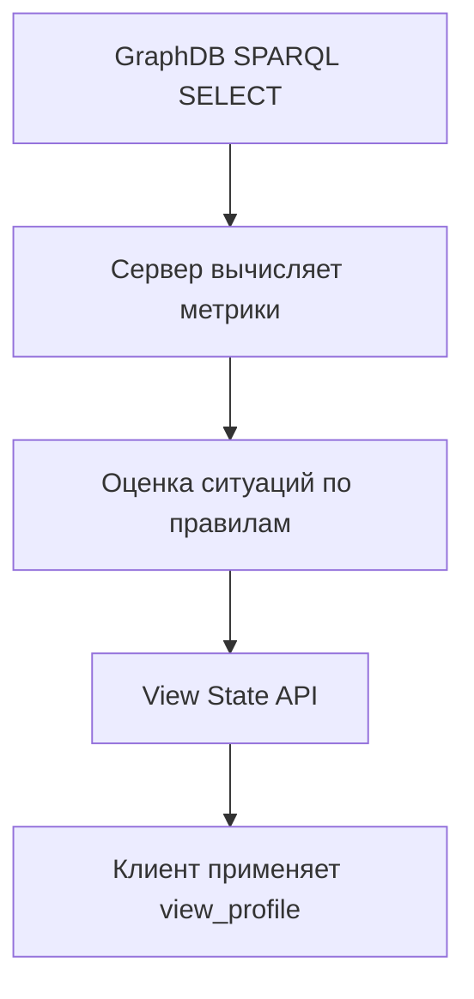

# Архитектура умного дашборда и roadmap

## Цель
Сделать «умный» дашборд, который автоматически меняет представление данных (секции, виджеты, фильтры и приоритеты) в зависимости от ситуаций, вычисляемых на базе уже готовых графов в GraphDB и правил из онтологии.

## Контекст проекта (кратко)
- Дашборд читает RDF через SPARQL `SELECT` из GraphDB и отдаёт JSON через HTTP API.
- Есть три страницы: «Пульс сделок», «Пульс лидов», «Сотрудники».
- Онтология содержит сущности: Deal, Lead, Activity, User, Category, Source, Stage и набор доступных признаков.

## Архитектура решения

### 1) Слой правил (Rule Engine)
**Назначение:** описывать ситуации и трансформации UI в декларативном виде.

**Формат правил (предложение):** JSON/YAML файл, например `rules/smart_view_rules.yaml`.
- `situation` — идентификатор и описание.
- `when` — условия с порогами (например, доля красных сделок > X, рост среднего времени реакции на лиды > Y).
- `effect` — целевое представление: какие блоки показывать/скрывать, какой приоритет/фокус, какие фильтры активировать по умолчанию.

### 2) Слой вычисления ситуаций (Situation Evaluator)
**Назначение:** вычислять показатели для условий `when` исключительно на основе готовых графов GraphDB.

**Где считать:** сервер (Python) для единообразия и минимизации логики в клиенте.

**Что использовать:**
- существующие SPARQL-запросы и агрегаты из `queries/`;
- новые агрегаты, получаемые `SELECT`-запросами к GraphDB, без модификации графов (read-only).

### 3) Слой представления (Adaptive View Model)
**Назначение:** приводить вычисленные ситуации к «состоянию вида».

**Модель состояния вида:**
- `active_situations`: список активных ситуаций и их приоритет.
- `view_profile`: набор UI-изменений (видимость блоков, приоритет сортировки, активный фильтр, подсветка).

### 4) API контракт
**Новый endpoint (предложение):**
- `GET /api/view-state` — возвращает `active_situations` и `view_profile` для страницы.

### 5) Клиентская интеграция
**Назначение:** применить `view_profile` к DOM-структуре страниц.

**Принцип:**
- страница рендерит все блоки,
- затем применяет правила видимости/приоритета/фильтрации из `view_profile`.

---

## Набор ситуаций (первичная версия)

### Сделки
1. **Всплеск красных сделок**
   - Условие: доля «красных сделок» > порога за 7 дней (данные из GraphDB).
   - Эффект: блок «Красные сделки» поднимается вверх; график активности доп. подсветка; фильтр категории активен.

2. **Застой по активности**
   - Условие: рост доли сделок с `lastActivityTime` > 30 дней.
   - Эффект: приоритет графика распределения активности; блок с последними активностями вверху.

### Лиды
3. **Рост времени реакции на лид**
   - Условие: среднее время до первой активности > порога; тренд на 30 дней растёт.
   - Эффект: показывать «Пульс активностей по лидам» выше, включить фильтр «ответственный».

4. **Провал конверсии лид→сделка**
   - Условие: снижение конверсии в сделку P за 30 дней.
   - Эффект: поднимать график «Пульс конвертации» и таблицу красных лидов.

### Сотрудники
5. **Нагрузка на сотрудников**
   - Условие: рост портфеля активных сделок у топ-20 сотрудников.
   - Эффект: таблица сотрудников — вверху, фильтр «категория портфеля» активен.

---

## Roadmap (по этапам)

1. **Формализация правил**
   - Выбрать формат (JSON/YAML) и место хранения в проекте.
   - Описать 4–6 базовых ситуаций с порогами и эффектами.

2. **Вычисление метрик для ситуаций**
   - Добавить/расширить SPARQL-запросы.
   - Реализовать вычисление агрегатов на сервере через `SELECT` к GraphDB (без изменения графов).

3. **API для состояния вида**
   - Реализовать endpoint `GET /api/view-state`.
   - Согласовать схему ответа.

4. **Интеграция в UI**
   - Добавить обработчик состояния вида на страницах.
   - Применять `view_profile` для отображения блоков.

5. **Верификация**
   - Подготовить тестовые данные (в рамках существующих графов).
   - Проверить переключение видов при изменении метрик.

---

## Схема (Mermaid)

---

## Открытые вопросы
- Какие пороги использовать по умолчанию для каждой ситуации.
- Нужно ли хранить историю ситуаций (например, журнал переключений).
- Требуется ли отдельный интерфейс для управления правилами (админка).
